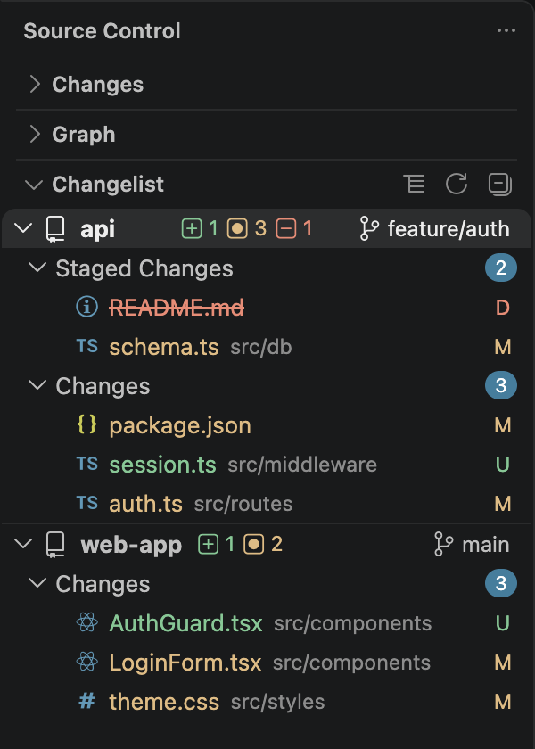

# Changelist

A PyCharm-style changes view for VS Code's Source Control. It lists only the repositories that have changes, each with its branch, a count of what changed and its files, so a workspace with many repositories stays short.



## Features

- **Only what changed.** Repositories without changes are left out, and a repository shows up as soon as you change something in it. When nothing has changed anywhere, the view says so.
- **Grouped like the built-in view.** Each repository's files are grouped into Merge Changes, Staged Changes, Changes and Untracked Changes, with the number of files in each group. Staged Changes is green, so it's clear which one you're looking at.
- **Changelists, like in PyCharm.** Split a repository's changes into named lists, like _Feature X_ or _Don't commit_. Right-click a repository or a group for _New Changelist..._, and a file, folder or group for _Move to Changelist..._. Untracked files can go in a list too. Each list has its own _Commit_ button, which commits its files and nothing else, and offers to unstage the files from other lists first. The repository's own _Commit_ and _Stage All Changes_ leave the lists alone, so a _Don't commit_ list stays out of your commits. The lists are saved for the workspace on your machine. Git and the built-in Source Control view don't know about them, so a commit from there takes whatever is staged.
- **The repository at a glance.** Each repository's row has its name in bold, how many files were added, modified, deleted or have conflicts, in Git's colors, and its branch. Click the branch to switch to another one.
- **Worktrees and submodules.** A worktree gets the worktree icon and is listed right below the repository it belongs to, indented in the Repositories panel, and its tooltip says which one. A submodule gets the submodule icon, like in the built-in view.
- **Commit and stage from the row.** Hover over a repository for _Commit_ and _Stage All Changes_. _Commit_ asks for a message, shared with the built-in message box, and offers to stage everything that isn't in a changelist first when nothing is staged.
- **Every repository's sync status.** The _Repositories_ button in the view's title bar swaps the changes for every repository, also the ones without changes, with its branch and how many commits it has to pull and push. Push, pull, sync or publish a branch with its button, click the branch to switch to another one, or fetch them all with _Fetch All_. The arrow in the title bar, or `Escape`, takes you back to the changes. Repositories with commits to push or pull have their name in bold, and the button gets a dot and the view says how many. A `*` after the name means uncommitted changes. Right-click a repository to fetch it, open it in a new window, reveal it or copy its path. How far behind a branch is comes from Git's last fetch, so use _Fetch All_ or turn on `git.autofetch`.
- **Files like in the Explorer.** Files get your file icon theme's icons, their name in their Git color, the status letter, and a line through deleted files. Click a file to see its changes. Hover over it to open the file, stage or unstage it, or discard its changes.
- **Discard what you don't want.** _Discard All Changes_ on the Changes and Untracked Changes groups, and on their folders, asks before it discards anything. Untracked files are deleted, and the question says so.
- **List or tree.** Show each group as a flat list with the folder next to each file, or as a folder tree where folders with a single folder inside are joined, like `src/app`. Switch with the button in the view's title bar.
- **Right-click menus.** Every row has its actions in a right-click menu too, also from the keyboard with `Shift+F10`.
- **Keyboard friendly.** The view is a single Tab stop. Move with the arrow keys, `Home` and `End`; `Left` and `Right` also collapse and expand; `Enter` or `Space` opens a file, toggles a group, or runs a repository's button in the Repositories panel.
- **Fits in.** Collapse or expand everything from the title bar, and collapsed rows are remembered while the view is hidden. The view uses your color theme, follows `scm.alwaysShowActions` to always show the row buttons, and shows tooltips after `workbench.hover.delay`, like the rest of VS Code.

## Install

- **VS Code:** search for **Changelist** in the Extensions view, or install it from the [VS Code Marketplace](https://marketplace.visualstudio.com/items?itemName=mackans95.source-control-changelist).
- **VSCodium, Cursor, Windsurf and other editors that use Open VSX:** search for **Changelist** in the Extensions view, or install it from [Open VSX](https://open-vsx.org/extension/mackans95/source-control-changelist).
- **From a file:** download the `.vsix` from a [GitHub release](https://github.com/mackans95/source-control-changelist/releases) and run `code --install-extension source-control-changelist-<version>.vsix`.

## Usage

Open a folder or workspace with one or more Git repositories, and open the **Source Control** view. **Changelist** is a section there, below the built-in **Changes**. You can drag it elsewhere, or collapse the built-in section if you only want this one.

## Settings

| Setting | Default | Description |
|---|---|---|
| `changelist.viewMode` | `list` | How each group shows its files: `list` as a flat list, with the folder next to each file, or `tree` as a folder tree. |

These VS Code settings change the view too:

| Setting | What it does here |
|---|---|
| `scm.alwaysShowActions` | Shows the buttons on every row all the time, instead of only on the row under the mouse. |
| `workbench.hover.delay` | How long the mouse rests on a row or button before its tooltip shows. |
| `workbench.iconTheme` | The icons of files and folders. |

## Requirements

VS Code 1.82 or later, with the built-in Git extension turned on (`git.enabled`). Like Git, the view doesn't run in Restricted Mode or in virtual workspaces.

## Known limitations

- VS Code doesn't share file icon themes with extensions, so the view reads the theme itself and matches files by name. A file whose language VS Code only recognizes from its contents, like a script with a `#!` line, gets the theme's default file icon, and only `*.ext` and plain file names in `files.associations` are used.
- Some of what VS Code's own trees do isn't there yet: selecting several rows, dragging files, and typing to filter.
- Tooltips stay inside the view, so long paths wrap onto several lines.
- After turning `git.enabled` on, reload the window to see your changes.

## Development

```sh
npm install
npm run watch
```

Press `F5` in VS Code to start an Extension Development Host, and open a folder that contains several Git repositories in that window. `npm run build` builds once; `npm test` runs the tests, and `npm run typecheck`, `npm run lint` and `npm run format:check` run the checks.
